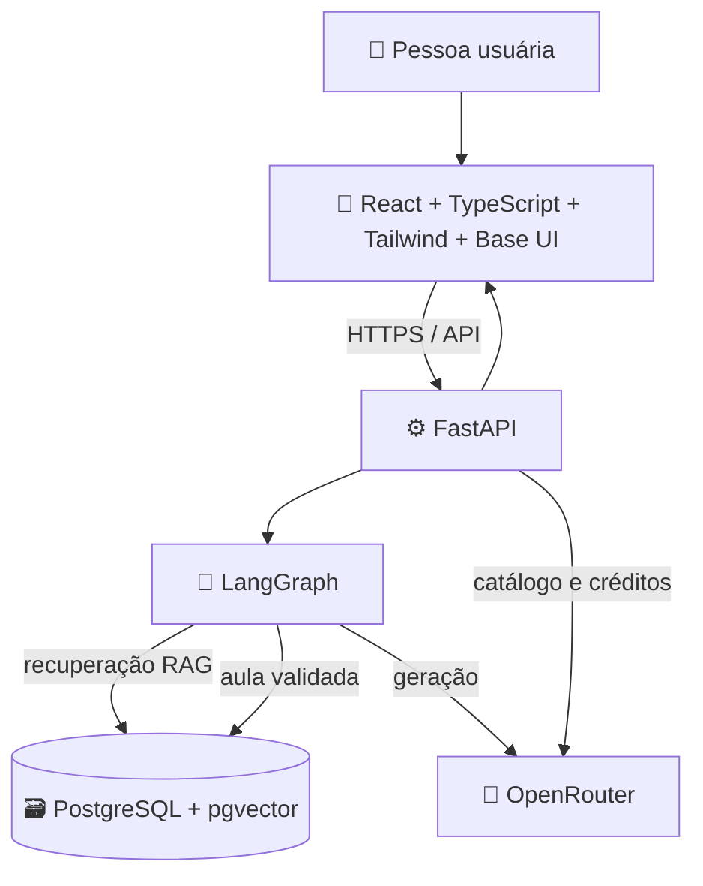

# Plano: Tutor Pessoal de Tecnologia

## 1. Visão do produto

Construir uma aplicação pessoal de aprendizagem em que a pessoa informa um tema de tecnologia e recebe uma explicação didática, estruturada e adaptada ao seu histórico. A aplicação deve guardar aulas, preferências e materiais próprios para recuperar contexto em consultas futuras.

**Princípio de “continuar aprendendo”:** a aplicação melhora a personalização por meio de histórico, notas, avaliações e RAG. Isso não significa retreinar automaticamente o modelo nem tratar respostas anteriores como fatos verificados. Conteúdo salvo deve manter origem e ser recuperável/removível pela pessoa usuária.

## 2. Experiência principal

1. A pessoa configura com segurança sua chave do OpenRouter e escolhe um modelo.
2. Informa o que quer aprender, opcionalmente seu nível e objetivo.
3. O tutor recupera contexto relevante das aulas e notas existentes.
4. O tutor gera uma aula com as seções abaixo, valida a estrutura e apresenta o resultado.
5. A pessoa avalia a aula, salva notas e consulta o histórico; esses dados ajudam a personalizar futuras respostas.

### Estrutura de cada aula

- **Introdução:** o que é o tema, conceitos essenciais e vocabulário.
- **Para que é utilizado:** casos de uso e quando escolher — ou não — a tecnologia.
- **Como é utilizado:** passos progressivos, exemplos práticos e códigos formatados com syntax highlighting.
- **Diagramas:** Mermaid que expliquem fluxos, componentes ou funcionamento, com rótulos didáticos, ícones Unicode/emoji e cores acessíveis.
- **Referências para aprofundar:** vídeos do YouTube, livros e artigos, com título, autor/canal, URL e breve justificativa. Sempre que possível, separar referências fornecidas por integrações/busca das sugestões geradas pelo modelo; não inventar links ou atribuições.
- **Resumo e próximos passos:** pontos-chave e sugestões de estudo relacionadas ao nível informado.

### Markdown e blocos de código

- Renderizar a resposta Markdown em modo **Preview** por padrão, com botão **Preview / Code** para alternar entre a visualização renderizada e o Markdown-fonte.
- Em blocos de código, oferecer visualização com syntax highlighting e acesso ao código-fonte; incluir ação de copiar.
- Em blocos Mermaid, oferecer diagrama renderizado e código Mermaid, com botão **Preview / Code** e estado de erro legível se o diagrama for inválido.
- Não executar código fornecido pelo modelo no navegador ou no servidor.

## 3. Stack e arquitetura proposta

### Frontend

- React, TypeScript, Vite e Tailwind CSS.
- Base UI para primitivas acessíveis e não estilizadas: <https://base-ui.com/llms.txt>.
- Atomic Design para organizar a interface em átomos, moléculas, organismos, templates e páginas; evitar criar camadas artificiais para componentes triviais.
- Tema dark como padrão, implementado com a estratégia `dark` do Tailwind CSS e tokens de cor consistentes: <https://tailwindcss.com/docs/dark-mode>.
- Renderização de Markdown segura, syntax highlighting e renderizador Mermaid. Sanitizar HTML/Markdown e restringir recursos externos para reduzir XSS.

### Backend e persistência

- Python e FastAPI: necessário para intermediar chamadas ao OpenRouter sem expor a chave no frontend, controlar o fluxo LangGraph e persistir dados.
- PostgreSQL com `pgvector`: dados relacionais, histórico, checkpoints do LangGraph e vetores para RAG.
- LangGraph para orquestrar geração, recuperação, validação, persistência e tratamento de falhas.
- Camada de embeddings substituível. Na implementação, verificar disponibilidade e compatibilidade do modelo escolhido antes de usar embeddings via OpenRouter; como alternativa, usar um provedor local. Não acoplar a aplicação a um modelo de embeddings indisponível.
- Redis e workers não são necessários no MVP; adicionar apenas se tarefas assíncronas, filas ou escala justificarem.

### Serviços em desenvolvimento/execução

- `web`: aplicação React/Vite.
- `api`: FastAPI e fluxo LangGraph.
- `db`: PostgreSQL com extensão `pgvector`.
- Orquestração local por Docker Compose, com volumes para persistência e health checks.
- Makefile com comandos comuns, por exemplo: `make up`, `make down`, `make dev`, `make logs`, `make test`, `make lint` e `make migrate`.

## 4. OpenRouter: modelos, chave e créditos

### Catálogo de LLMs

- Consultar o catálogo oficial por `GET https://openrouter.ai/api/v1/models` a partir do backend, normalizar os metadados e disponibilizar pesquisa/filtros na tela de configurações.
- Apresentar, conforme disponível no catálogo, identificador, nome, contexto, modalidades, capacidades e preços de entrada/saída. Não fixar uma relação de modelos no código: disponibilidade, nomes, preços e recursos mudam.
- Permitir escolher um modelo e definir um modelo padrão configurável. Validar que o modelo selecionado ainda existe antes de iniciar uma geração e explicar como corrigir uma seleção indisponível.
- A lista mostrada na aplicação é a lista atual devolvida pelo endpoint oficial; fonte: <https://openrouter.ai/api/v1/models> e documentação <https://openrouter.ai/docs/api-reference/models/list-models>.

### Configuração segura da chave

- Campo de entrada mascarado na interface, com ação para cadastrar/substituir e opção de validar a chave; nunca retornar o segredo em respostas da API.
- Enviar a chave somente ao backend. Em produção, exigir HTTPS. No modo local, aceitar acesso apenas no ambiente de desenvolvimento.
- Criptografar a chave antes de persistir, usando uma chave de criptografia fornecida por secret do ambiente/Compose e separada do banco. Permitir também configuração por secret para deploys sem formulário.
- Nunca armazenar a chave no bundle React, `localStorage`, logs, mensagens de erro, telemetria ou repositório. Manter `.env` fora do Git; oferecer `.env.example` apenas com nomes de variáveis e valores fictícios.
- Não devolver o valor persistido: a interface deve mostrar somente estado configurado/ausente e permitir substituição ou remoção.
- Restringir a chave no painel do OpenRouter quando possível, aplicar limites de uso, e documentar rotação e revogação. Se houver múltiplos usuários no futuro, separar segredos por usuário e introduzir autenticação/autorização antes de disponibilizar o serviço publicamente.

### Verificação periódica de créditos

- O backend consulta `GET https://openrouter.ai/api/v1/credits`, com autenticação Bearer usando a chave configurada.
- Intervalo configurável em segundos ou minutos, por configuração de ambiente e tela de configurações, com um limite mínimo para evitar consultas excessivas.
- Um agendador consulta e guarda o último resultado e horário; a interface lê o estado armazenado e mostra créditos/saldo, horário da última atualização e erros recuperáveis. Tratar limites de taxa, timeout, chave inválida e falha de rede sem interromper a geração de aulas.
- Documentar o comportamento ao executar mais de uma réplica da API: garantir um único agendador ou usar lock distribuído antes de escalar.
- Fonte: <https://openrouter.ai/docs/api-reference/credits/get-credits>.

## 5. Fluxo de geração com LangGraph e RAG

Fluxo inicial proposto:

1. **Receber pedido:** tema, nível, objetivo, idioma e preferências opcionais.
2. **Classificar e planejar:** identificar escopo e produzir um plano curto para a aula.
3. **Recuperar contexto:** buscar aulas, notas e preferências relacionadas; aplicar filtros para que dados de outras pessoas nunca sejam recuperados.
4. **Gerar aula:** chamar o modelo selecionado pelo OpenRouter com formato e instruções didáticas definidos.
5. **Validar saída:** conferir se as seções obrigatórias existem, se blocos de código/Mermaid estão delimitados e se referências têm formato adequado. Não alegar que uma URL foi verificada sem verificá-la.
6. **Persistir e responder:** salvar aula, modelo, timestamps e fontes/contexto usados; devolver conteúdo estruturado ao frontend.
7. **Feedback:** guardar avaliação e notas, usando-as em recuperações e personalização futuras, sem alterar silenciosamente o conteúdo histórico.

Começar com RAG sobre aulas salvas, notas e referências aprovadas. Cada fragmento deve guardar proveniência (aula/documento, data, URL quando aplicável) e metadados. Permitir apagar conteúdo e reindexá-lo. A busca vetorial deve ser combinada com filtros/metadados e, se necessário, busca textual.

## 6. Modelo de dados inicial

- `settings`: modelo padrão, intervalo de créditos e preferências de estudo.
- `provider_credentials`: segredo cifrado e metadados mínimos; nunca registrar o segredo em texto claro.
- `lessons`: tema, nível, objetivo, conteúdo estruturado, modelo, datas e estado.
- `references`: tipo (vídeo, livro, artigo), título, autor/canal, URL, descrição e estado de verificação.
- `notes`: notas pessoais ligadas a tema/aula e controle de inclusão no RAG.
- `lesson_feedback`: avaliação e comentário opcional.
- `knowledge_chunks`: texto/chunk, embedding, proveniência e metadados para recuperação.
- `credit_snapshots`: saldo/créditos, horário consultado e estado da consulta; não armazenar a chave nem cabeçalhos de autenticação.
- Checkpoints do LangGraph persistidos no PostgreSQL, associados ao fluxo e usuário quando houver autenticação.

## 7. Contratos de API iniciais

- `GET /api/models`: lista em cache os modelos atualmente disponíveis no OpenRouter.
- `GET /api/settings`: configurações sem segredos.
- `PUT /api/settings`: atualiza modelo padrão, intervalo de consulta e preferências.
- `PUT /api/settings/openrouter-key`: valida e armazena uma chave cifrada; não a devolve.
- `DELETE /api/settings/openrouter-key`: remove a chave armazenada.
- `GET /api/openrouter/credits`: retorna o último snapshot e estado da consulta; não precisa disparar uma chamada externa a cada leitura.
- `POST /api/lessons`: cria uma aula via LangGraph e devolve o conteúdo estruturado.
- `GET /api/lessons` e `GET /api/lessons/{id}`: histórico e detalhe.
- `POST /api/lessons/{id}/feedback`: guarda avaliação.
- `POST /api/notes` e `DELETE /api/notes/{id}`: gestão de notas e conteúdo pessoal para RAG.

Usar Pydantic para validar entrada/saída, limites de tamanho, timeouts, erros tipados e documentação OpenAPI. A autenticação é dispensável somente no MVP local de uso pessoal; não expor endpoints de chave, dados ou créditos numa instalação pública sem autenticação.

## 8. Organização da interface (Atomic Design)

- **Átomos:** botão, campo, badge, ícone, seletor de tema.
- **Moléculas:** campo de busca de tema, seletor de modelo, indicador de créditos, controle Preview/Code.
- **Organismos:** cabeçalho/navegação, formulário de aula, painel de resposta Markdown, cartão Mermaid, biblioteca de aulas.
- **Templates:** layout principal dark e layout de configuração.
- **Páginas:** Tutor, Histórico/Biblioteca e Configurações.

Considerar estados de carregamento, vazio, erro de provider, chave ausente, modelo indisponível, resposta parcial e diagrama inválido. Garantir navegação por teclado, contraste e semântica acessível; Base UI oferece primitivas, mas a aplicação é responsável pela composição visual e tokens.

## 9. Agentes e skills especializadas

Criar definições pequenas, com escopo, entradas/saídas e limites claros; agentes auxiliam o desenvolvimento e não recebem segredos reais. Cada skill deve conter comandos de validação e links para documentação oficial pertinente.

| Agente | Responsabilidade | Skills associadas |
|---|---|---|
| `frontend-architect` | React, TypeScript, Vite, Atomic Design e integração Base UI | `react-typescript`, `vite`, `base-ui`, `atomic-design` |
| `design-system-specialist` | Tailwind, tema dark, acessibilidade e estados visuais | `tailwind-css`, `dark-mode`, `a11y` |
| `backend-api-specialist` | FastAPI, contratos Pydantic, integração segura com OpenRouter | `python-fastapi`, `openrouter-api`, `secrets-security` |
| `ai-orchestration-specialist` | Grafos LangGraph, prompts, validação e tratamento de falhas | `langgraph`, `llm-evaluation`, `prompt-safety` |
| `rag-data-specialist` | PostgreSQL, pgvector, embeddings, chunking e proveniência | `postgresql`, `pgvector`, `rag` |
| `platform-engineer` | Docker Compose, Makefile, migrações, CI e observabilidade | `docker-compose`, `makefile`, `database-migrations` |
| `content-rendering-specialist` | Markdown seguro, syntax highlighting e Mermaid Preview/Code | `markdown-rendering`, `mermaid`, `content-security` |

As skills devem orientar tarefas repetíveis (padrões, riscos e validações), não duplicar documentação extensa nem conter API keys. Versionar os agentes/skills junto do projeto após confirmar a convenção de diretórios da ferramenta adotada.

## 10. Etapas de implementação

### Fase 1 — Fundação

- Definir estrutura frontend/backend, Docker Compose, variáveis de ambiente de exemplo, Makefile e lint/testes.
- Subir PostgreSQL com `pgvector`, configurar migrações e health checks.
- Implementar layout dark, navegação e componentes base acessíveis com Base UI/Tailwind.

### Fase 2 — OpenRouter e segurança

- Implementar catálogo dinâmico de modelos, seleção e modelo padrão.
- Implementar cadastro/validação/remoção de chave com criptografia em repouso e redação de logs.
- Implementar consulta agendada de créditos, configuração do intervalo, snapshots e estados de erro.

### Fase 3 — Tutor e renderização

- Implementar contrato da aula, criação via LangGraph e streaming somente se necessário.
- Renderizar Markdown com Preview/Code, syntax highlighting, copiar código e Mermaid com Preview/Code.
- Adicionar validação de saída e testes com respostas simuladas, sem depender de chamadas pagas durante a suíte normal.

### Fase 4 — Histórico e RAG

- Persistir e listar aulas, notas, preferências, referências e feedback.
- Adicionar embeddings, indexação, busca híbrida/filtrada, proveniência e remoção/reindexação.
- Avaliar relevância e qualidade com um conjunto pequeno de perguntas e documentos de teste.

### Fase 5 — Agentes, endurecimento e entrega

- Criar e documentar os agentes e skills da tabela, sem segredos.
- Revisar autenticação se a instalação deixar de ser exclusivamente local, limites de requisição, proteção de dados, backups e observabilidade.
- Executar testes integrados do Compose e documentar instalação, configuração, rotação da chave e operação.

## 11. Critérios de aceite

- É possível configurar a chave sem que ela apareça no bundle, armazenamento do navegador, respostas da API ou logs; a chave persistida está cifrada.
- A tela apresenta modelos obtidos do catálogo atual do OpenRouter e permite definir o modelo padrão.
- Os créditos são consultados no intervalo configurado e a interface mostra o último estado sem bloquear o tutor em caso de falha nessa consulta.
- Um pedido gera uma aula com introdução, usos, exemplos, diagrama e referências, com mensagens claras quando o provider falha.
- Markdown, código e Mermaid têm controles Preview/Code; código recebe syntax highlighting; nenhum código é executado.
- Aulas e notas são persistidas; RAG usa conteúdo pertinente com proveniência e não mistura dados entre usuários.
- `docker compose` inicia os serviços e o Makefile documenta os comandos principais; testes e lint rodam sem credenciais reais.
- Tema dark, navegação por teclado, contraste e estados de erro/carregamento são verificados.

## 12. Riscos e decisões a confirmar durante a implementação

- O catálogo, preços, limites e capacidades do OpenRouter são dinâmicos: não apresentar dados em cache como atuais sem mostrar o horário da atualização.
- Referências geradas por LLM podem ser imprecisas. Priorizar fontes verificáveis e identificar claramente sugestões não validadas.
- A chave precisa de mecanismo de criptografia persistente e backups seguros; perder a chave de cifragem impede recuperar credenciais cifradas.
- PostgreSQL/pgvector é suficiente para o MVP; Redis, serviços de busca e fine-tuning ficam fora do escopo até haver necessidade comprovada.
- Para uso remoto/multiusuário, autenticação, isolamento por usuário, quotas e política de retenção tornam-se requisitos antes da publicação.
